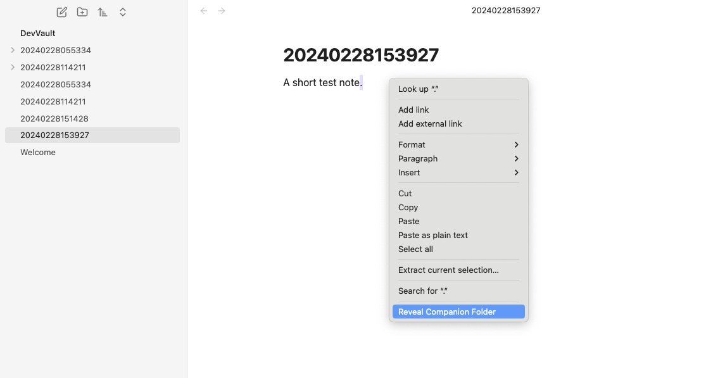
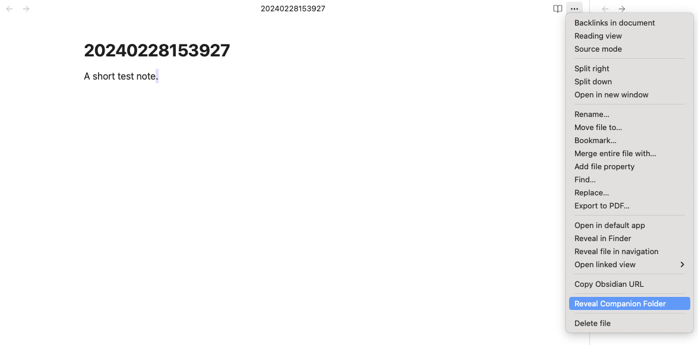
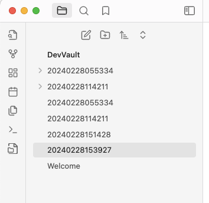
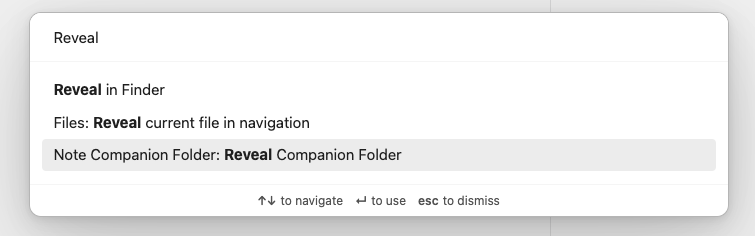

# Note Companion Folder Plugin

Manage a separate folder of attachments for each note. The folder name is the same as the note name minus the file extension. The plugin's default behavior is to have the companion folder as a sibling to the note, but you can configure this.

You can use the companion folder to keep the attachments separated on a per-note level instead of having a single attachments folder for all notes in a vault.

## Two modes

Either keep the companion folder directly next to the note like this:

```
vault-folder/
|- note-file.md
|- note-file/
||- attachment-0.png
```

Or you can choose a subpath inside the vault where the companion folders (for all notes will reside). Set the `Base path for companion folders` option in the plugin settings to `_file`, then the layout in the file system would look like this:

```
vault-folder/
|-_files/
||- note-file/
|||- attachment-0.png
| note-file.md
```

This plugin provides multiple ways to reveal a companion folder for a given note:

- A ribbon icon
- A command
- A context action
- A file action 

If the companion folder for a given one does not exist, it will be created upon invoking one of the plugin's commands or actions.









## Install

You can find the "Note Companion Folder" in the list of community plugins!

## Development

### Building

- `npm run dev` - Start development mode with file watching
- `npm run build` - Build production version with type checking

### Testing

This plugin includes a comprehensive unit test suite using Jest.

**Run tests:**
```bash
npm test              # Run all tests
npm run test:watch    # Run tests in watch mode
npm run test:coverage # Run tests with coverage report
```

**Test structure:**
- `tests/` - Test files and helpers
- `tests/mocks/` - Mock implementations of Obsidian API
- `tests/test-helpers.ts` - Utility functions for creating test fixtures
- `tests/path-resolution.test.ts` - Tests for companion folder path resolution logic
- `tests/file-operations.test.ts` - Tests for file drop handling and file naming logic
- `tests/settings.test.ts` - Tests for plugin settings and configuration

The test suite covers:
- Path resolution for companion folders (sibling and base path modes)
- Folder existence checks
- File name conflict resolution
- Drag and drop handling setup
- Plugin settings management and persistence